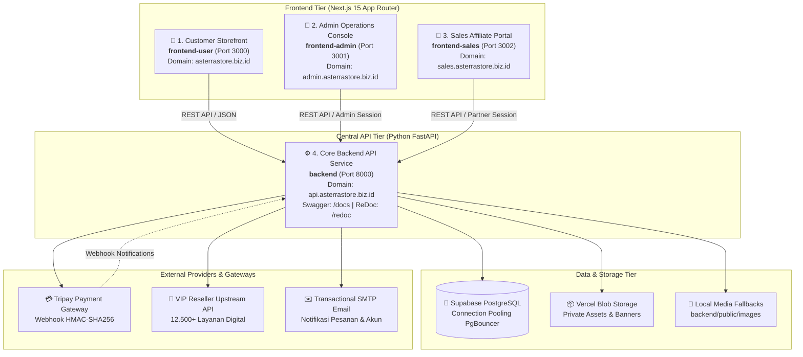
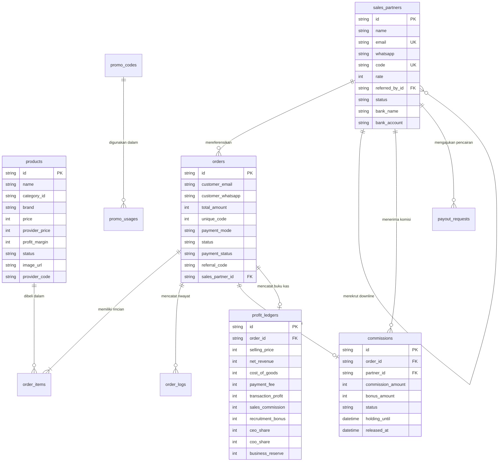

# Asterra Store — Distributed E-Commerce Ecosystem

> **Platform E-Commerce Produk Digital & Layanan Premium Multi-Aplikasi**  
> Arsitektur Terpisah (*Decoupled Multi-Project*): FastAPI Core Backend, Next.js Storefront, Next.js Admin Console, dan Next.js Sales Portal.

---

## 📌 Daftar Isi

1. [Ringkasan Eksekutif & Identitas Proyek](#-1-ringkasan-eksekutif--identitas-proyek)
2. [Topologi Arsitektur Decoupled (Multi-Repo / Monorepo)](#-2-topologi-arsitektur-decoupled-multi-repo--monorepo)
3. [Spesifikasi 4 Sub-Aplikasi Utama](#-3-spesifikasi-4-sub-aplikasi-utama)
   - [3.1 Backend Core API (Pure Python FastAPI)](#31-backend-core-api-pure-python-fastapi)
   - [3.2 Frontend Customer Storefront (Next.js 15)](#32-frontend-customer-storefront-nextjs-15)
   - [3.3 Frontend Admin Operations Hub (Next.js 15)](#33-frontend-admin-operations-hub-nextjs-15)
   - [3.4 Frontend Sales & Affiliate Portal (Next.js 15)](#34-frontend-sales--affiliate-portal-nextjs-15)
4. [Skema Basis Data & Entitas Utama (PostgreSQL Supabase)](#-4-skema-basis-data--entitas-utama-postgresql-supabase)
5. [Model Keuangan & Waterfall Profit Distribution](#-5-model-keuangan--waterfall-profit-distribution)
6. [Integrasi Pihak Ketiga & Infrastruktur](#-6-integrasi-pihak-ketiga--infrastruktur)
7. [Daftar Lengkap API Endpoints (FastAPI)](#-7-daftar-lengkap-api-endpoints-fastapi)
8. [Panduan Instalasi & Menjalankan Lokal](#-8-panduan-instalasi--menjalankan-lokal)
9. [Konfigurasi Environment (.env) & Script Switcher](#-9-konfigurasi-environment-env--script-switcher)
10. [Operasional, Pemeliharaan & Skrip Bantu](#-10-operasional-pemeliharaan--skrip-bantu)
11. [Protokol Keamanan & Hardening Produksi](#-11-protokol-keamanan--hardening-produksi)

---

## 🏛️ 1. Ringkasan Eksekutif & Identitas Proyek

**Asterra Store** adalah platform e-commerce produk digital modern terdistribusi yang dirancang untuk melayani penjualan akun premium (*AI Tools* seperti ChatGPT Plus, Claude Pro, Google Gemini Advanced; *Apps & Streaming* seperti Netflix, YouTube Premium, Spotify, Canva Pro, CapCut Pro; serta *Layanan Digital* lainnya).

Sistem ini berevolusi dari *Next.js Fullstack Monolith* menjadi **Decoupled Distributed Architecture** guna memecahkan masalah performa, risiko keamanan, pembengkakan bundle JS admin, serta keterbatasan serverless timeout saat sinkronisasi supplier massal (12.500+ SKU).

### Karakteristik Kunci:
- **Asynchronous Core Engine**: Backend berkinerja tinggi menggunakan Python FastAPI dengan SQLAlchemy 2.0 ORM.
- **Micro-Frontend Domains**: Tiga portal web Next.js 15 App Router independen untuk Pembeli Publik, Tim Admin, dan Mitra Sales/Affiliate.
- **Multi-Gateway Payment**: Integrasi Tripay (QRIS dinamis, Virtual Account, E-Wallet) dan Pembayaran Manual Transfer BCA dengan verifikasi kode unik 3 digit otomatis.
- **Affiliate & Network Bonus Engine**: Sistem komisi berjenjang otomatis (10% profit penjualan langsung + 2% bonus rekrutmen sponsor) dengan periode *escrow holding* untuk proteksi fraud/refund.
- **Supplier Auto-Fulfillment**: Sinkronisasi katalog dan eksekusi pesanan terintegrasi dengan VIP Reseller API.

---

## 🌐 2. Topologi Arsitektur Decoupled (Multi-Repo / Monorepo)

Struktur proyek menerapkan pemisahan tanggung jawab domain (*Single Responsibility Principle*):



### Pemisahan Port & Domain:

| Sub-Aplikasi | Folder | Port Dev | Domain Produksi | Deskripsi |
|---|---|---|---|---|
| **Core Backend** | `backend/` | `8000` | `https://api.asterrastore.biz.id` | Pusat logika bisnis, REST API, Pydantic DTO, orkestrasi transaksi |
| **Customer Storefront** | `frontend-user/` | `3000` | `https://asterrastore.biz.id` | Katalog publik, keranjang, checkout instan, pelacakan pesanan |
| **Admin Operations** | `frontend-admin/` | `3001` | `https://admin.asterrastore.biz.id` | 26 modul SaaS executive hub, katalog, analitik, refund, RBAC |
| **Sales & Affiliate** | `frontend-sales/` | `3002` | `https://sales.asterrastore.biz.id` | Dashboard mitra affiliate, tautan referral, pohon tim, pencairan |

---

## 📦 3. Spesifikasi 4 Sub-Aplikasi Utama

### 3.1 Backend Core API (Pure Python FastAPI)
- **Lokasi**: [`backend/`](file:///c:/Iqbal/Development/Project%20Library/NextJS/Asterra%20Store/backend)
- **Teknologi**: Python 3.10+, FastAPI 0.115+, SQLAlchemy 2.0, Pydantic v2, Uvicorn, Psycopg2, HTTPX, PyJWT.
- **Tanggung Jawab**:
  - Menyediakan single source of truth (SSOT) untuk validasi data dan kalkulasi finansial.
  - Menghitung **Waterfall Profit Distribution** secara deterministik (menghindari selisih pembulatan).
  - Melindungi batas bawah harga melalui **Floor Price Protection** agar diskon/voucher tidak menggerus modal dasar (COGS).
  - Menangani webhook pembayaran Tripay dengan validasi tanda tangan HMAC-SHA256 yang aman.
  - Melayani endpoint `/media/{path}` dengan sistem fallback cerdas: Vercel Blob -> Local File -> Default Banner SVG/PNG.
  - Menyediakan dokumentasi OpenAPI otomatis di `/docs` (Swagger) dan `/redoc` (ReDoc).

### 3.2 Frontend Customer Storefront (Next.js 15)
- **Lokasi**: [`frontend-user/`](file:///c:/Iqbal/Development/Project%20Library/NextJS/Asterra%20Store/frontend-user)
- **Teknologi**: Next.js 15 (App Router), React 19, TypeScript, Tailwind CSS, Zustand, GSAP Motion, FontAwesome, Radix UI.
- **Fitur Utama**:
  - **Katalog Cepat**: Filter kategori (`AI Tools`, `Apps & Streaming`, `Layanan Digital`) dan pencarian in-memory berlatensi rendah.
  - **Modal Detail Produk**: Penjelasan spesifikasi akun, garansi penuh, durasi langganan, dan tipe pengiriman.
  - **Keranjang Belanja (Cart Drawer)**: Pengelolaan keranjang multi-item dengan state persist via Zustand.
  - **Checkout Cerdas**:
    - Mode Payment Gateway: QRIS dinamis, BCA/Mandiri/BRI Virtual Account, OVO/DANA.
    - Mode Transfer Manual: Nomor rekening BCA toko dengan penambahan **3 digit kode unik** otomatis untuk verifikasi instan.
    - Input kode voucher / referral sales yang langsung memicu potongan harga.
  - **Pelacakan Pesanan (`/orders/[id]`)**: Halaman pelacakan real-time untuk status `pending`, `processing`, `completed`, hingga penerimaan kredensial akun digital.

### 3.3 Frontend Admin Operations Hub (Next.js 15)
- **Lokasi**: [`frontend-admin/`](file:///c:/Iqbal/Development/Project%20Library/NextJS/Asterra%20Store/frontend-admin)
- **Teknologi**: Next.js 15, React 19, TypeScript, Tailwind CSS, TanStack Query, Lucide Icons.
- **26 Modul SaaS Command Center**:
  1. **Dashboard Executive**: KPI Omzet, profit bersih, pesanan aktif, rasio refund, dan grafik tren harian.
  2. **Katalog Produk**: Manajemen produk aktif/arsip, penyesuaian harga, fitur highlight, dan margin profit.
  3. **Manajemen Kategori**: Struktur taksonomi katalog, pengurutan hierarki, dan display badge.
  4. **VIP Reseller Explorer**: Penelusuran 12.500+ layanan supplier upstream, filter in-memory, dan aksi *one-click import*.
  5. **Status Supplier & Provider**: Health check latency API supplier, tingkat keberhasilan pemrosesan order.
  6. **Pesanan Pelanggan**: Antrian pesanan real-time, filter status pembayaran, input kredensial pesanan manual.
  7. **CRM Pelanggan 360**: Data pembeli, akumulasi Lifetime Value (LTV), riwayat order, deep link WhatsApp CS.
  8. **Refund & Komplain**: Resolution center komplain pelanggan, replacement akun, catatan audit internal.
  9. **Manajemen Mitra Affiliate**: Daftar sales representative, verifikasi pendaftar baru, status aktivasi.
  10. **Voucher & Kode Promo**: Kupon diskon persentase/nominal, kuota penggunaan, tanggal kedaluwarsa.
  11. **Campaign Studio**: Penjadwalan promo tematik, flash sale, dan banner promo.
  12. **Storefront CMS & Banner**: Pengaturan hero carousel, upload banner responsif mobile/desktop.
  13. **Multi-Wallet Treasury**: Pemantauan saldo gateway Tripay, saldo deposit VIP Reseller, dan dana cadangan garansi.
  14. **Analisis Pendapatan**: Rincian penjualan kotor, distribusi metode pembayaran (QRIS vs VA vs Manual).
  15. **Pusat Biaya (Cost Center)**: Pencatatan COGS supplier dan pengeluaran operasional (OpEx).
  16. **Kalkulator Waterfall Profit**: Audit margin bersih per transaksi secara transparan.
  17. **General Ledger (Jurnal Keuangan)**: Pembukuan riwayat mutasi debit/kredit per transaksi.
  18. **Sales BI Analytics**: Time-series revenue, Average Order Value (AOV), unit ranking.
  19. **Matriks Performa Produk**: Analisis margin kotor per SKU vs tingkat retur/komplain.
  20. **Telemetri Performa Sales**: Konversi klik referral menjadi pesanan berhasil.
  21. **Laporan Laba/Rugi Formal**: Statement Income formal P&L dengan fitur print & ekspor file.
  22. **Konfigurasi Pembayaran**: Pengaturan akun BCA, DANA, upload QRIS manual, switch mode gateway/manual.
  23. **Log & Audit Gateway**: HTTP audit log, payload webhook Tripay, latency inspection.
  24. **Pengirim Pesan Notifikasi**: Templating notifikasi WhatsApp otomatis via bot gateway.
  25. **Kelola Staff & Admin (RBAC)**: Pembuatan akun Superadmin/Admin, reset sandi, hak akses.
  26. **Pengaturan Master Toko**: Profil toko, identitas legal, nomor CS, garansi toko, SEO meta.

### 3.4 Frontend Sales & Affiliate Portal (Next.js 15)
- **Lokasi**: [`frontend-sales/`](file:///c:/Iqbal/Development/Project%20Library/NextJS/Asterra%20Store/frontend-sales)
- **Teknologi**: Next.js 15, React 19, TypeScript, Tailwind CSS, TanStack Query, Radix UI.
- **Fitur Utama**:
  - **Formulir Pendaftaran Publik (`/daftar-sales`)**:
    - Validasi nomor WhatsApp dan email aktif.
    - Pilihan kode referral custom pribadi (misal: `ASTERRA-SULTAN`).
    - Dukungan kode sponsor pengajak via URL parameter `?ref=KODE_PENGAJAK` dengan validasi real-time.
    - Simulator kalkulator komisi interaktif berbasis proyeksi transaksi bulanan.
  - **Console Mitra Suite (`/sales`)**:
    - Kartu KPI: Total komisi siap cair (*Available*), komisi masa garansi (*Holding*), dan riwayat dicairkan (*Paid*).
    - Generator Tautan Referral: Pembuatan link affiliate per produk maupun tautan katalog utama.
    - Riwayat Pesanan Referral: Log order pelanggan yang menggunakan kode referral mitra.
    - Jaringan Rekrutmen (Team Tree): Struktur downline mitra yang direkrut beserta akumulasi bonus 2%.
    - Penarikan Dana (Payout Withdrawal): Pengajuan transfer komisi ke rekening bank mitra.

---

## 🗄️ 4. Skema Basis Data & Entitas Utama (PostgreSQL Supabase)

Database diorkestrasi menggunakan PostgreSQL pada Supabase dengan dukungan relasional penuh:



### Penjelasan Model Utama:
- **`products`**: Menyimpan katalog produk digital, harga jual, modal supplier (`provider_price`), margin kotor, dan badge highlight garansi.
- **`orders`**: Header pesanan pelanggan, rincian biaya, mode pembayaran (`gateway` vs `manual`), kode unik, dan ID mitra referral.
- **`order_items`**: Baris produk dalam pesanan, durasi masa aktif, serta email/telepon target tujuan pengiriman akun.
- **`order_logs`**: Jejak audit komprehensif setiap perubahan pesanan oleh admin, webhook payment, atau sistem otomatis.
- **`sales_partners`**: Profil mitra sales affiliate, kode unik, tingkat komisi standar (10%), serta relasi sponsor (*self-referential* `referred_by_id`).
- **`commissions`**: Catatan komisi per pesanan dengan status `pending` (selama periode proteksi garansi), `final` (tersedia), atau `reversed` (jika pesanan dibatalkan/refund).
- **`profit_ledgers`**: Buku besar akuntansi pencatatan profit bersih, biaya payment gateway, bonus rekrutmen tim, dan dividen operasional.
- **`payout_requests`**: Antrian penarikan saldo komisi mitra ke rekening bank lokal dengan status approval admin.
- **`payment_settings`**: Konfigurasi dinamis pembayaran toko (nama bank BCA, QRIS image URL, nomor CS WhatsApp, toggle kode unik).

---

## 💰 5. Model Keuangan & Waterfall Profit Distribution

Untuk memastikan integritas finansial dan profitabilitas bisnis yang terukur, seluruh pesanan diproses melalui alur matematis yang ketat:

```
┌─────────────────────────────────────────────────────────────┐
│ 1. Harga Jual Kotor (Selling Price)                         │
│    - Diskon Referral Pelanggan (Customer Referral Discount) │
│ ─────────────────────────────────────────────────────────── │
│ = PENDAPATAN BERSIH (Net Revenue)                           │
│                                                             │
│    - Modal Pokok Supplier / COGS (Cost of Goods Sold)       │
│    - Biaya Gerbang Pembayaran / PG Fee (Payment Fee)        │
│ ─────────────────────────────────────────────────────────── │
│ = PROFIT TRANSAKSI (Transaction Profit)                     │
│                                                             │
│    - Komisi Mitra Sales Langsung (10% dari Profit)          │
│    - Bonus Rekrutmen Sponsor Tim (2% dari Profit)           │
│ ─────────────────────────────────────────────────────────── │
│ = DISTRIBUSI PROFIT BERSIH BISNIS (Net Business Profit)     │
│    • 45% Bagian CEO / Pendiri                               │
│    • 45% Bagian COO / Operasional                           │
│    • 10% Dana Cadangan Usaha & Garansi (Reserve Fund)       │
└─────────────────────────────────────────────────────────────┘
```

### Mekanisme Proteksi Finansial:
1. **Floor Price Protection**: Sistem secara otomatis menolak kode voucher atau promosi jika harga akhir berada di bawah batas minimum:
   $$\text{Harga Minimal} = \text{COGS Supplier} + \text{Biaya Payment Gateway} + \text{Ambang Profit Minimal}$$
2. **Escrow Holding Period**: Komisi mitra affiliate dikunci dalam status `pending` selama **7 hari** (atau masa garansi produk) sebelum berubah menjadi `available`. Jika terjadi refund atas keluhan akun bermasalah, komisi ditarik kembali secara otomatis (*auto-reversal*) tanpa membocorkan kas perusahaan.

---

## 🔌 6. Integrasi Pihak Ketiga & Infrastruktur

### 1. Gerbang Pembayaran Tripay (`app.services.tripay_service`)
- Mendukung mode **Sandbox / Development** dan **Production**.
- Webhook terproteksi verifikasi HMAC-SHA256:
  ```python
  signature = hmac.new(
      private_key.encode("utf-8"),
      raw_body,
      hashlib.sha256
  ).hexdigest()
  ```
- Mendukung pembaruan status transaksi otomatis dari `PAID` menjadi `processing` atau `completed`.

### 2. Supplier Digital VIP Reseller (`app.services.catalog_service`)
- Penjelajah katalog 12.500+ SKU layanan digital dengan markup profit dinamis.
- Pemantauan live status ketersediaan stok supplier secara periodik.

### 3. Vercel Blob & Local CDN Fallback (`app.main.get_media_file`)
- Akses penyimpanan media privat via header autentikasi bearer token Vercel Blob.
- Fallback bertingkat: jika token blob tidak dikonfigurasi, sistem menyajikan file dari direktori lokal [`backend/public/`](file:///c:/Iqbal/Development/Project%20Library/NextJS/Asterra%20Store/backend/public) atau menyajikan banner cadangan bawaan toko (`default-product-banner.png`).

---

## 🚀 7. Daftar Lengkap API Endpoints (FastAPI)

Semua endpoint backend berpusat di prefix `/api/v1` dan dimounting paralel di `/v1`:

### 🛒 Katalog & Produk
- `GET /products`: Ambil daftar katalog produk publik (dengan filter kategori & pencarian).
- `GET /products/{id}`: Ambil detail produk berdasarkan ID.
- `GET /admin/products`: Ambil produk untuk admin beserta total metrik inventori.
- `POST /admin/products`: Tambah produk baru ke katalog.
- `PATCH /admin/products/{id}`: Perbarui rincian produk.
- `DELETE /admin/products/{id}`: Hapus produk dari katalog.
- `POST /admin/products/{id}/toggle-status`: Toggle aktif/arsip produk.
- `POST /admin/products/bulk-status`: Ubah status produk secara massal.
- `POST /admin/products/bulk-delete`: Hapus produk secara massal.
- `GET /admin/vip-services`: Telusuri layanan upstream VIP Reseller (hingga 2.500+ item).
- `POST /admin/vip-services`: Impor layanan VIP Reseller ke katalog toko.
- `POST /admin/sync-vip`: Sinkronisasi massal seluruh layanan supplier.

### 💳 Pembayaran & Konfigurasi
- `GET /payment-config`: Ambil info metode pembayaran untuk checkout pembeli.
- `GET /admin/payment-config`: Ambil konfigurasi pembayaran untuk dashboard admin.
- `POST /admin/payment-config`: Perbarui rekening BCA, gambar QRIS, dan aturan pembayaran.
- `POST /webhooks/tripay`: Endpoint penerima callback webhook transaksi Tripay.

### 🎟️ Kupon & Promosi
- `POST /promos/validate`: Validasi kelayakan kode voucher terhadap subtotal keranjang.
- `GET /admin/promos`: Daftar seluruh kode promo dan metrik penggunaan.
- `POST /admin/promos`: Buat kode promo baru.
- `PATCH /admin/promos/{id}`: Edit atau toggle status aktif promo.
- `DELETE /admin/promos/{id}`: Hapus kode promo.

### 📦 Manajemen Pesanan
- `POST /orders`: Buat pesanan baru (Storefront checkout).
- `GET /orders`: Ambil daftar riwayat pesanan (filter status/email).
- `GET /orders/{id}`: Ambil detail pesanan & invoice.
- `POST /orders/{id}/pay`: Inisiasi pembayaran pesanan.
- `POST /orders/{id}/cancel`: Batalkan pesanan.
- `GET /admin/orders`: Daftar antrian pesanan dengan pagination dan metrik realtime.
- `GET /admin/orders/{id}`: Detail pesanan lengkap untuk tim admin.
- `PATCH /admin/orders/{id}/status`: Perbarui status pesanan (processing, completed, cancelled).

### 🤝 Kemitraan Sales & Affiliate
- `GET /affiliate/validate-referral`: Validasi keberadaan kode referral mitra di checkout/pendaftaran.
- `POST /affiliate/register`: Pendaftaran publik mitra sales baru.
- `POST /affiliate/track-click`: Pelacakan telemetri klik tautan referral.
- `GET /sales/me`: Profil mitra sales yang sedang login.
- `GET /sales/orders`: Riwayat pesanan yang dihasilkan oleh referral mitra.
- `GET /sales/network`: Data jaringan downline dan bonus tim mitra.
- `POST /sales/payout`: Pengajuan penarikan saldo komisi mitra.
- `GET /admin/affiliates`: Daftar seluruh mitra affiliate untuk tim admin.
- `POST /admin/affiliates/payout`: Persetujuan pencairan komisi oleh admin.

### 📊 Keuangan, Analitik & Audit
- `GET /admin/profit-distribution`: Rincian distribusi profit bisnis.
- `GET /admin/finance/summary`: Ringkasan kas, pendapatan kotor, beban COGS, dan profit bersih.
- `GET /admin/analytics/overview`: Ringkasan KPI dan grafik time-series.
- `GET /admin/analytics/suite`: Data analitik BI lengkap untuk laporan manajemen.
- `GET /admin/customers`: CRM data pelanggan dan riwayat transaksi.
- `GET /admin/logs`: Log audit teknis dan event gateway.

### 🎨 Banners, Kampanye & Media
- `GET /banners`: Banner aktif publik untuk tampilan hero storefront.
- `GET /admin/banners`: Daftar seluruh banner manajemen.
- `POST /admin/banners`: Tambah banner baru.
- `PATCH /admin/banners/{id}/toggle-status`: Toggle visibilitas banner.
- `DELETE /admin/banners/{id}`: Hapus banner.
- `GET /campaigns/active`: Kampanye promo & flash sale aktif.
- `GET /admin/campaigns`: Manajemen studio kampanye promosi admin.
- `GET /media/{media_path}`: Streaming media gambar dari Vercel Blob atau asset lokal.

### 🔐 Autentikasi & RBAC Admin
- `POST /admin/auth/login`: Login akun superadmin/admin portal.
- `GET /admin/auth/me`: Verifikasi sesi aktif admin.
- `POST /admin/auth/logout`: Revokasi sesi login admin.
- `GET /admin/users`: Daftar akun admin pengelola sistem.
- `POST /admin/users`: Tambah akun staff admin baru.

---

## 🛠️ 8. Panduan Instalasi & Menjalankan Lokal

### Prasyarat:
- **Node.js**: v18.18+ atau v20.x+
- **Python**: v3.10+ atau v3.11+
- **NPM**: v9+ atau v10+
- **PostgreSQL**: Supabase Database URL aktif

### Langkah 1: Kloning & Instalasi Dependensi

```bash
# 1. Kloning repository
git clone https://github.com/iqbaltech07/Asterra-Store.git
cd "Asterra Store"

# 2. Setup Virtual Environment Python untuk Backend
cd backend
python -m venv venv

# Windows:
venv\Scripts\activate
# Linux/macOS:
# source venv/bin/activate

pip install -r requirements.txt
cd ..

# 3. Instal Dependensi Frontend (User, Admin, Sales)
npm --prefix frontend-user install
npm --prefix frontend-admin install
npm --prefix frontend-sales install
```

### Langkah 2: Konfigurasi Environment Lokal

Gunakan skrip pengalih otomatis bawaan:
```bash
# Mengaktifkan .env.development untuk seluruh 4 aplikasi:
npm run env:dev
```

### Langkah 3: Menjalankan Aplikasi Secara Bersamaan

Buka 4 terminal terpisah atau jalankan skrip berikut:

```bash
# Terminal 1: Backend FastAPI (Port 8000)
npm run dev:backend

# Terminal 2: Customer Storefront (Port 3000)
npm run dev:user

# Terminal 3: Admin Operations Console (Port 3001)
npm run dev:admin

# Terminal 4: Sales Representative Portal (Port 3002)
npm run dev:sales
```

### URL Akses Lokal:
- 🛒 **Customer Storefront**: [http://localhost:3000](http://localhost:3000)
- 💼 **Admin Console**: [http://localhost:3001](http://localhost:3001) *(Login: admin@asterra.store / AsterraAdmin#2026)*
- 🤝 **Sales Portal**: [http://localhost:3002](http://localhost:3002)
- ⚙️ **FastAPI Swagger Docs**: [http://localhost:8000/docs](http://localhost:8000/docs)
- 📖 **FastAPI ReDoc**: [http://localhost:8000/redoc](http://localhost:8000/redoc)

---

## ⚙️ 9. Konfigurasi Environment (.env) & Script Switcher

Proyek ini dilengkapi dengan skrip automasi [`scripts/switch-env.js`](file:///c:/Iqbal/Development/Project%20Library/NextJS/Asterra%20Store/scripts/switch-env.js) yang dapat mengalihkan konfigurasi ke-4 aplikasi sekaligus hanya dengan satu perintah:

```bash
# Mode Pengembangan Lokal (Localhost 8000, 3000, 3001, 3002):
npm run env:dev

# Mode Produksi Live (Domain *.asterrastore.biz.id):
npm run env:prod
```

### Struktur Variabel Penting:

#### 1. Backend ([`backend/.env.example`](file:///c:/Iqbal/Development/Project%20Library/NextJS/Asterra%20Store/backend/.env.example))
```ini
ENVIRONMENT=development
PORT=8000
DATABASE_URL="postgresql://postgres:[PASSWORD]@[HOST]:6543/postgres?pgbouncer=true"
DIRECT_URL="postgresql://postgres:[PASSWORD]@[HOST]:5432/postgres"
ALLOWED_ORIGINS="http://localhost:3000,http://localhost:3001,http://localhost:3002,https://asterrastore.biz.id,https://admin.asterrastore.biz.id,https://sales.asterrastore.biz.id"
SECRET_KEY="super-secret-jwt-signing-key-min-32-chars"
TRIPAY_API_KEY="DEV-your-tripay-key"
TRIPAY_PRIVATE_KEY="your-tripay-private-key"
TRIPAY_MERCHANT_CODE="T12345"
TRIPAY_IS_PRODUCTION=false
BLOB_READ_WRITE_TOKEN="vercel_blob_rw_token_placeholder"
VIP_RESELLER_BASE_URL="https://vip-reseller.co.id/api"
```

#### 2. Frontend Applications (`frontend-*/.env.example`)
```ini
NODE_ENV=development
BACKEND_URL=http://localhost:8000
NEXT_PUBLIC_API_URL=http://localhost:8000
NEXT_PUBLIC_APP_URL=http://localhost:3000 # (3001 untuk admin, 3002 untuk sales)
DATABASE_URL="postgresql://postgres:[PASSWORD]@[HOST]:6543/postgres?pgbouncer=true"
JWT_SECRET="asterra_jwt_secret_dev_change_in_production_min32chars"
```

---

## 🧰 10. Operasional, Pemeliharaan & Skrip Bantu

Pada direktori [`scripts/`](file:///c:/Iqbal/Development/Project%20Library/NextJS/Asterra%20Store/scripts), tersedia kumpulan utilitas otomasi pemeliharaan:

| Skrip | Perintah Eksekusi | Deskripsi |
|---|---|---|
| `switch-env.js` | `node scripts/switch-env.js [dev\|prod]` | Menyalin `.env.development` / `.env.production` ke `.env` di seluruh 4 repositori. |
| `generate-product-excel.js` | `node scripts/generate-product-excel.js` | Mengekspor seluruh katalog produk Supabase ke file Excel terstruktur (`products_export.xlsx`). |
| `apply_excel_prices_to_db.js` | `node scripts/apply_excel_prices_to_db.js` | Menerapkan pembaruan harga massal dari file Excel hasil revisi ke database Supabase. |
| `sync-supabase-to-json.js` | `node scripts/sync-supabase-to-json.js` | Sinkronisasi data katalog dari Supabase ke file snapshot lokal `data/products.json` untuk offline fallback. |
| `reset-sales-data.ts` | `npx ts-node scripts/reset-sales-data.ts` | Skrip pengujian untuk membersihkan/mereset data transaksi dummy mitra sales. |
| `test-audit.py` | `python scripts/test-audit.py` | Menguji integritas jejak audit (`order_logs`) dan kalkulasi profit ledger. |
| `test_db.py` | `python scripts/test_db.py` | Menguji konektivitas langsung ke Supabase PostgreSQL melalui driver psycopg2. |

---

## 🛡️ 11. Protokol Keamanan & Hardening Produksi

1. **Isolasi Token & Hak Akses (RBAC)**:
   - Sesi token admin (`admin_token`) memiliki signature dan secret berbeda dengan token pelanggan maupun mitra sales.
   - Endpoint admin pada backend dilindungi oleh dependency verifikasi hak akses peran (*Role-Based Access Control*).
2. **Perimeter Keamanan Webhook**:
   - Webhook Tripay menolak payload apapun yang tidak memiliki header `X-Callback-Signature` valid atau timestamp kedaluwarsa.
3. **Regex Whitelist CORS**:
   - Backend membatasi origin hanya pada domain resmi `asterrastore.biz.id`, subdomainnya, serta localhost port tertentu saat development.
4. **Proteksi Kode Unik Anti-Fraud**:
   - Setiap transaksi transfer manual menghasilkan 3 digit angka acak (misal: Rp 45.312) untuk mendeteksi kesesuaian mutasi rekening secara presisi.
5. **Asset Streaming Deduplication**:
   - File media dilindungi proxy streaming sehingga token akses penyimpanan Vercel Blob tidak pernah bocor ke sisi klien publik.

---

## 📄 Lisensi & Tim Pengembang

- **Lisensi**: Proyek ini dilindungi oleh lisensi kepemilikan privat internal Asterra Store (Lihat [`LICENSE`](file:///c:/Iqbal/Development/Project%20Library/NextJS/Asterra%20Store/LICENSE)).
- **Pengembang**: Tim Rekayasa Antigravity & Asterra Digital Engineering.
