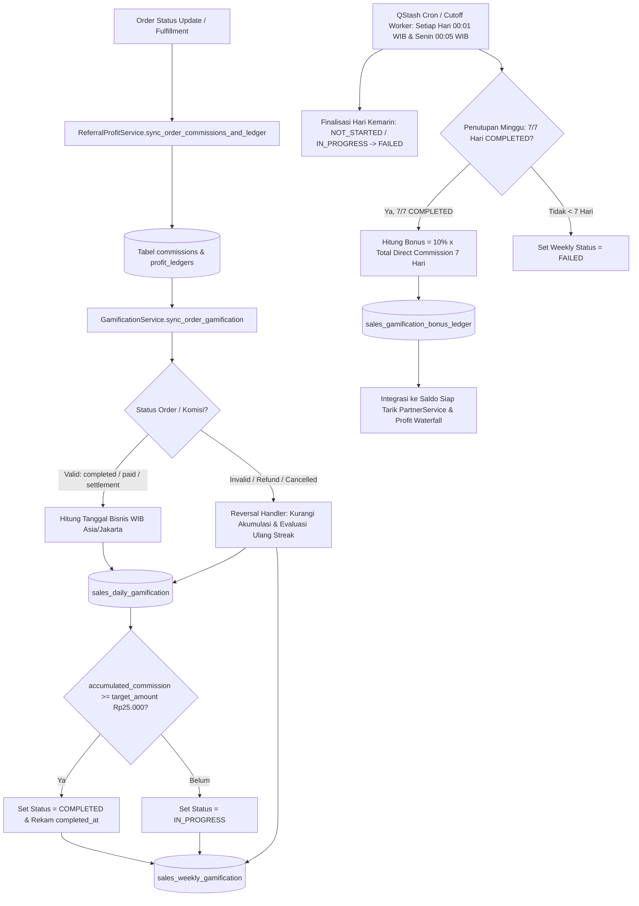

# Sales Gamification System — Architecture & Implementation Plan
**Project:** Asterra Store  
**Source PRD:** [`frontend-sales/gamification.md`](./gamification.md)  
**Graphify Baseline Commit:** `f077561b`  
**Status:** Ready for Implementation  

---

## 1. Hasil Analisis Proyek Menggunakan Graphify

Knowledge graph proyek telah diperbarui menggunakan `graphify update .` pada commit `f077561b` (`graphify-out/GRAPH_REPORT.md`):

- **Skala Korpus:** `483 files` · `3.932 nodes` · `9.427 edges` · `209 communities` (`0` siklus import terdeteksi).
- **God Nodes (Abstraksi Inti Paling Terhubung):**
  1. `OrderService` (71 edges) — `backend/app/services/order_service.py`
  2. `PartnerService` (65 edges) — `backend/app/services/partner_service.py`
  3. `RealtimeBroadcaster` (57 edges) — `backend/app/services/realtime_broadcaster.py`
  4. `CatalogService` (56 edges) — `backend/app/services/catalog_service.py`
  5. `VipService` (47 edges) — `backend/app/services/vip_service.py`
  6. `Order` Model (45 edges) — `backend/app/models/order.py`
  7. `CardService` (44 edges) — `backend/app/services/card_service.py`

### Temuan Arsitektural dari Graphify & Audit Codebase

1. **Single Source of Truth (SSOT) Komisi & Profit:**
   - Seluruh perhitungan komisi bermuara pada `ReferralProfitService.sync_order_commissions_and_ledger()` di `backend/app/services/referral_profit_service.py`.
   - Method ini dipanggil secara otomatis dari:
     - `OrderService.update_status()` saat order berubah status (`completed`, `paid`, `settlement`, `cancelled`, `refunded`, `expired`).
     - `OrderProcessingService.complete_manual_order()` saat fulfillment manual selesai.
     - `OrderPostTasks.execute()` saat order baru dibuat (`pending`).
     - `PartnerService.get_orders_for_partner()` sebagai auto-sync idempotent.
   - Data disimpan secara idempotent di tabel PostgreSQL `commissions` (`backend/app/models/commission.py`) dan `profit_ledgers` (`backend/app/models/profit_ledger.py`) menggunakan tipe **Integer Rupiah** (tanpa floating-point drift).

2. **Penyelarasan Skema Komisi (Model Bisnis v2.0 vs Ilustrasi PRD):**
   - Di `model-bisnis.md` (Model Bisnis v2.0) dan `referral_profit_service.py` (`DIRECT_RATE_DEFAULT = 30.0`), komisi langsung sales saat ini adalah **30% dari Transaction Profit** (dengan `SPONSOR_RATE_DEFAULT = 0.0`).
   - Sementara di Section 7 `gamification.md` tertulis ilustrasi model lama (Direct 10% + Recruitment 2%).
   - **Solusi Arsitektural:** Sesuai instruksi Section 10 & 15 di `gamification.md` (*"Jangan menghitung ulang komisi secara terpisah dengan formula yang berbeda dari commission engine utama"*), sistem gamification membaca nilai `commission_amount` langsung dari tabel `commissions` / `ReferralProfitService`. Dengan demikian, berapa pun rate komisi aktif (30% atau 10%), gamification selalu 100% akurat mengikuti commission engine utama, dan `Weekly Bonus = 10% × Total Direct Sales Commission` tetap berarti tambahan 10% di atas komisi langsung yang diperoleh sales selama 7 hari berturut-turut.

3. **Temuan Graphify pada Struktur Frontend (Mirrored Components):**
   - Query Graphify pada `SalesOverviewTab()` mengungkap bahwa komponen portal sales ada di **dua tempat**:
     - `frontend-sales/src/components/sales/` (Portal mandiri mitra sales di port 3002).
     - `frontend-admin/src/components/sales/` (View sales di dalam Admin Console).
   - Selain itu, di `frontend-sales/src/components/sales/tabs/sales-overview-tab.tsx` (baris 574–652), kartu **"Produk Komisi Tertinggi"** saat ini masih menggunakan **3 item hardcoded** (Google Gemini Pro, CapCut Pro, YouTube Premium). Bagian ini akan diupgrade menjadi **Product Suggestion Engine** dinamis sesuai PRD.

4. **Mekanisme Migrasi, Cron, & Realtime:**
   - **Database Migration:** Dijalankan secara idempotent saat startup melalui `run_migrations()` di `backend/app/core/db_migration.py` + dokumentasi skema di `backend/docs/schema.prisma`.
   - **Cron & Background Worker:** Menggunakan kombinasi **Upstash QStash** (`register_cron_job` di `backend/app/core/qstash_client.py`) dan background worker di `lifespan` `backend/app/main.py`.
   - **Realtime UI Update:** Menggunakan SSE `RealtimeBroadcaster.broadcast()` untuk mengirim update instan ke portal Sales dan Admin.

---

## 2. Diagram Arsitektur & Alur Sistem Gamification

---

## 3. Desain Data Model & Skema Database

Sesuai Section 10 & 15 PRD, seluruh nilai uang disimpan sebagai `INTEGER` (Rupiah bulat, konsisten dengan `Commission` dan `ProfitLedger` di codebase saat ini) untuk mencegah selisih pembulatan floating-point.

### 3.1. Tabel `sales_gamification_configs` (Konfigurasi Global & Audit)
Menyimpan pengaturan dinamis yang dapat diubah Admin tanpa mengubah histori periode yang sudah ditutup:

| Field | Type | Default | Description |
|---|---|---|---|
| `id` | `VARCHAR(50)` | `'default'` | Primary key |
| `is_enabled` | `BOOLEAN` | `TRUE` | Status aktif fitur gamification |
| `daily_target_amount` | `INTEGER` | `25000` | Target komisi harian (Rp25.000) |
| `weekly_streak_days` | `INTEGER` | `7` | Durasi hari berturut-turut (7 hari) |
| `weekly_bonus_percentage` | `NUMERIC(5,2)` | `10.00` | Persentase bonus mingguan (10%) |
| `timezone` | `VARCHAR(50)` | `'Asia/Jakarta'` | Zona waktu perhitungan cutoff harian |
| `week_start_day` | `VARCHAR(20)` | `'MONDAY'` | Hari awal perhitungan siklus mingguan |
| `product_suggestion_enabled` | `BOOLEAN` | `TRUE` | Status aktif fitur rekomendasi produk |
| `auto_approve_weekly_bonus` | `BOOLEAN` | `TRUE` | Otomatis setujui bonus setelah validasi mingguan |
| `updated_by` | `VARCHAR(100)` | `NULL` | Admin terakhir yang mengubah konfigurasi |
| `updated_at` | `TIMESTAMP` | `NOW()` | Waktu perubahan terakhir |

### 3.2. Tabel `sales_daily_gamification`
Menyimpan progress harian per sales berdasarkan kalender WIB (`00:00:00 – 23:59:59 WIB`):

| Field | Type | Description |
|---|---|---|
| `id` | `VARCHAR(100)` | Primary key |
| `sales_id` | `VARCHAR(100)` | FK → `sales_partners.id` (Indexed) |
| `date` | `DATE` | Tanggal bisnis WIB (Indexed) |
| `target_amount` | `INTEGER` | Snapshot target harian pada tanggal tersebut (default `25000`) |
| `accumulated_commission` | `INTEGER` | Total komisi langsung dari transaksi valid/completed |
| `estimated_pending_commission` | `INTEGER` | Estimasi komisi dari transaksi pending/processing (belum mengaktifkan streak) |
| `eligible_orders_count` | `INTEGER` | Jumlah transaksi valid hari tersebut |
| `status` | `VARCHAR(30)` | `NOT_STARTED` \| `IN_PROGRESS` \| `COMPLETED` \| `FAILED` |
| `completed_at` | `TIMESTAMP` | Waktu saat `accumulated_commission >= target_amount` tercapai |
| `created_at` | `TIMESTAMP` | Created timestamp |
| `updated_at` | `TIMESTAMP` | Updated timestamp |

- **Unique Constraint:** `UNIQUE(sales_id, date)`

### 3.3. Tabel `sales_weekly_gamification`
Menyimpan ringkasan mingguan dengan siklus kalender tetap (`Senin 00:00 WIB – Minggu 23:59 WIB`):

| Field | Type | Description |
|---|---|---|
| `id` | `VARCHAR(100)` | Primary key |
| `sales_id` | `VARCHAR(100)` | FK → `sales_partners.id` (Indexed) |
| `week_start` | `DATE` | Tanggal hari Senin WIB |
| `week_end` | `DATE` | Tanggal hari Minggu WIB |
| `completed_days` | `INTEGER` | Jumlah hari berstatus `COMPLETED` (`0..7`) |
| `total_commission` | `INTEGER` | Total direct sales commission valid selama 7 hari |
| `bonus_percentage` | `NUMERIC(5,2)` | Persentase bonus mingguan (`10.00`) |
| `bonus_amount` | `INTEGER` | Nominal bonus (`int(round(total_commission * bonus_percentage / 100))`) |
| `status` | `VARCHAR(30)` | `IN_PROGRESS` \| `COMPLETED` \| `FAILED` \| `BONUS_PENDING` \| `BONUS_APPROVED` \| `BONUS_PAID` |
| `bonus_paid_at` | `TIMESTAMP` | Waktu pencairan bonus |
| `created_at` | `TIMESTAMP` | Created timestamp |
| `updated_at` | `TIMESTAMP` | Updated timestamp |

- **Unique Constraint:** `UNIQUE(sales_id, week_start)`

### 3.4. Tabel `sales_gamification_bonus_ledger`
Buku besar audit terpisah untuk bonus mingguan:

| Field | Type | Description |
|---|---|---|
| `id` | `VARCHAR(100)` | Primary key |
| `sales_id` | `VARCHAR(100)` | FK → `sales_partners.id` (Indexed) |
| `weekly_gamification_id` | `VARCHAR(100)` | FK → `sales_weekly_gamification.id` |
| `bonus_type` | `VARCHAR(50)` | `'WEEKLY_STREAK'` |
| `base_commission` | `INTEGER` | Dasar perhitungan komisi langsung selama 7 hari |
| `bonus_percentage` | `NUMERIC(5,2)` | Persentase bonus (`10.00`) |
| `bonus_amount` | `INTEGER` | Nominal bonus dalam Rupiah bulat |
| `status` | `VARCHAR(30)` | `PENDING` \| `APPROVED` \| `PAID` \| `REVERSED` |
| `reversal_reason` | `TEXT` | Alasan pembatalan jika direversal |
| `approved_by` | `VARCHAR(100)` | Actor yang menyetujui (`system` / admin ID) |
| `created_at` | `TIMESTAMP` | Created timestamp |
| `approved_at` | `TIMESTAMP` | Waktu bonus disetujui |
| `paid_at` | `TIMESTAMP` | Waktu pembayaran |

- **Unique Constraint:** `UNIQUE(weekly_gamification_id, bonus_type)`

### 3.5. Tabel `sales_gamification_order_events` (Idempotency & Traceability Log)
Menjamin **1 transaksi tidak pernah menambah progress lebih dari 1 kali** dan memudahkan audit Admin untuk menelusuri transaksi pembentuk progress harian/mingguan:

| Field | Type | Description |
|---|---|---|
| `id` | `VARCHAR(100)` | Primary key |
| `order_id` | `VARCHAR(100)` | `UNIQUE`, FK → `orders.id` |
| `commission_id` | `VARCHAR(100)` | Referensi `commissions.id` |
| `sales_id` | `VARCHAR(100)` | FK → `sales_partners.id` (Indexed) |
| `daily_gamification_id` | `VARCHAR(100)` | FK → `sales_daily_gamification.id` (Indexed) |
| `wib_date` | `DATE` | Tanggal bisnis WIB transaksi |
| `direct_commission_amount` | `INTEGER` | Komisi langsung transaksi (tanpa recruitment bonus) |
| `is_counted` | `BOOLEAN` | `TRUE` jika transaksi valid/completed, `FALSE` jika pending/reversed |
| `order_status` | `VARCHAR(50)` | Status terakhir transaksi |
| `validated_at` | `TIMESTAMP` | Waktu transaksi tervalidasi |
| `reversed_at` | `TIMESTAMP` | Waktu transaksi direfund/dibatalkan |
| `updated_at` | `TIMESTAMP` | Updated timestamp |

---

## 4. Rencana Implementasi Bertahap (Step-by-Step Implementation Plan)

### Phase 1: Database Migration & SQLAlchemy Models
1. **Buat Model SQLAlchemy baru:**
   - Buat `backend/app/models/gamification.py` berisi model `SalesGamificationConfig`, `SalesDailyGamification`, `SalesWeeklyGamification`, `SalesGamificationBonusLedger`, dan `SalesGamificationOrderEvent`.
   - Ekspor seluruh model di `backend/app/models/__init__.py`.
2. **Update Idempotent Migration:**
   - Tambahkan DDL `CREATE TABLE IF NOT EXISTS` dan `CREATE UNIQUE INDEX IF NOT EXISTS` ke `run_migrations()` di `backend/app/core/db_migration.py` beserta dokumentasi rollback SQL.
   - Sinkronkan definisi model ke `backend/docs/schema.prisma`.

### Phase 2: Backend Core Engine (`GamificationService`)
Buat `backend/app/services/gamification_service.py` dengan komponen:

1. **Timezone & Calendar Helper (`Asia/Jakarta` / UTC+7):**
   - Konversi timestamp transaksi ke `WIB = timezone(timedelta(hours=7))`.
   - Kalkulasi `wib_date`, `week_start` (`date - timedelta(days=date.weekday())`), `week_end` (`week_start + timedelta(days=6)`), dan `seconds_until_midnight_wib`.

2. **Idempotent Daily Progress & Streak Processor (`sync_order_gamification`):**
   - Dipanggil setiap kali `ReferralProfitService.sync_order_commissions_and_ledger(order_id, new_status)` selesai dieksekusi.
   - Mengabaikan order `is_dummy == True`, order tanpa `sales_partner_id`, atau order dengan `sales_commission <= 0`.
   - Mengambil `commission_amount` murni dari `Commission` (tanpa menghitung `bonus_amount` / recruitment bonus).
   - Mencatat/memperbarui baris di `sales_gamification_order_events` dan menghitung ulang agregat `accumulated_commission` untuk `(sales_id, wib_date)` secara transaksional:
     - Jika `accumulated_commission == 0` dan masih hari berjalan → `NOT_STARTED`
     - Jika `0 < accumulated_commission < target_amount` → `IN_PROGRESS`
     - Jika `accumulated_commission >= target_amount` → `COMPLETED` (isi `completed_at` jika belum terisi).
   - Memperbarui agregat `sales_weekly_gamification` (`completed_days`, `total_commission`, dan estimasi `bonus_amount`).

3. **Reversal & Clawback Handler:**
   - Jika transaksi berubah menjadi `cancelled`, `refunded`, atau `expired`:
     - Tandai `is_counted = False` dan `reversed_at = now` pada `sales_gamification_order_events`.
     - Hitung ulang `accumulated_commission` pada `sales_daily_gamification`.
     - Apabila setelah dikurangi nilai komisi menjadi `< target_amount`, ubah status hari tersebut dari `COMPLETED` menjadi `IN_PROGRESS` (jika masih hari yang sama) atau `FAILED` (jika hari sudah lewat).
     - Evaluasi ulang `sales_weekly_gamification`: jika `completed_days < 7` dan bonus berstatus `PENDING` / `APPROVED` (belum dicairkan), batalkan bonus (`REVERSED`) dan kurangi estimasi bonus.

4. **Product Suggestion Engine (`get_product_suggestions`):**
   - Mengambil katalog aktif (`status == 'active'`, `stock > 0`, `provider_status` sehat) dari `CatalogService` & `Product`.
   - Menghitung estimasi komisi aktual per produk menggunakan formula `ReferralProfitService` (`(selling_price - provider_price - payment_fee) * partner_rate`).
   - Menghitung `remaining_target = max(0, daily_target - today_accumulated_commission)` (jika target hari ini sudah tercapai, gunakan `daily_target` Rp25.000 untuk simulasi target berikutnya).
   - Menghitung efisiensi transaksi:
     $$\text{Estimated Transactions Needed} = \lceil \text{Remaining Target} / \text{Estimated Commission per Transaction} \rceil$$
   - Menggabungkan skor efisiensi komisi, histori konversi/keberhasilan transaksi produk, dan melakukan **weighted random sampling** dengan parameter `exclude_ids` saat tombol **Refresh Suggestion** ditekan agar tidak mengulang produk yang sama terus-menerus.

5. **Daily Cutoff & Weekly Bonus Settlement Worker (`run_daily_and_weekly_cutoff`):**
   - Menutup semua record `sales_daily_gamification` untuk tanggal `< today_wib` yang masih `NOT_STARTED` atau `IN_PROGRESS` menjadi `FAILED`.
   - Menandai `sales_weekly_gamification` minggu berjalan menjadi `FAILED` lebih awal jika sudah terdapat hari masa lalu dalam minggu tersebut yang `FAILED` (atau tidak ada record `COMPLETED` pada hari yang telah lewat).
   - Pada penutupan minggu (Senin dini hari WIB untuk minggu sebelumnya):
     - Memeriksa apakah ke-7 hari (`Monday` s/d `Sunday`) berstatus `COMPLETED`.
     - Jika `completed_days == 7`, menghitung `bonus_amount = int(round(total_commission * (bonus_percentage / 100.0)))`.
     - Membuat record idempotent di `sales_gamification_bonus_ledger` (`UNIQUE(weekly_gamification_id, 'WEEKLY_STREAK')`) dengan status `APPROVED` (atau `PENDING` jika menunggu validasi holding 3 hari / approval admin).

### Phase 3: Integrasi dengan Wallet, Payout, & Laporan Keuangan
1. **`PartnerService` (`backend/app/services/partner_service.py`):**
   - Tambahkan perhitungan `gamificationBonus` (`approved` / `paid` dari `sales_gamification_bonus_ledger`) ke dalam `get_profile()` dan `get_all_partners()` sehingga bonus mingguan yang sudah `APPROVED` otomatis menambah `unpaidCommission` (Saldo Siap Tarik) dan tercatat di ringkasan komisi.
2. **`FinanceService` (`backend/app/services/finance_service.py`):**
   - Sertakan biaya `totalGamificationBonus` dalam ringkasan pengeluaran komisi dan laporan keuangan Admin agar dampak finansial (maksimal ekuivalen 10% dari direct commission) transparan dan dapat diaudit.
3. **Cron & Lifespan Worker (`backend/app/main.py`):**
   - Daftarkan jadwal QStash Cron `/api/v1/internal/cron/gamification-cutoff` serta background worker ringan di `lifespan` untuk memastikan pergantian hari WIB dan penutupan minggu berjalan otomatis.

### Phase 4: API Endpoints (Sales & Admin)
1. **Sales Endpoints di `backend/app/api/v1/sales.py`:**
   - `GET /api/v1/sales/gamification/overview` — Mengembalikan:
     - `dailyMission`: target, komisi terkumpul, komisi pending, persentase progress, sisa target, status (`NOT_STARTED` / `IN_PROGRESS` / `COMPLETED` / `FAILED`), countdown detik menuju 23:59:59 WIB, dan daftar transaksi hari ini.
     - `weeklyStreak`: tanggal mulai & akhir minggu, kalender 7 hari (Senin–Minggu beserta status & nominal per hari), total komisi minggu ini, estimasi bonus 10%, dan status kelayakan bonus.
     - `commissionSummary`: direct sales commission, weekly bonus commission, total komisi, dan riwayat bonus mingguan (`sales_gamification_bonus_ledger`).
   - `GET /api/v1/sales/gamification/suggestions?exclude=id1,id2` — Mengembalikan daftar rekomendasi produk efisien beserta estimasi komisi/transaksi dan jumlah transaksi yang dibutuhkan untuk mencapai sisa target harian (mendukung refresh tanpa duplikasi).
2. **Admin Endpoints di `backend/app/api/v1/sales.py` / `backend/app/api/v1/admin.py`:**
   - `GET /api/v1/admin/gamification/overview` — Metrik performa seluruh sales (completion rate harian/mingguan, daftar streak aktif seluruh sales, laporan biaya bonus gamification vs profit transaksi, riwayat bonus ledger, dan transaksi yang direversal).
   - `GET /api/v1/admin/gamification/sales/{sales_id}` — Rincian audit transaksi pembentuk progress harian/mingguan seorang sales.
   - `PUT /api/v1/admin/gamification/config` — Update konfigurasi (`daily_target_amount`, `weekly_bonus_percentage`, `is_enabled`, `product_suggestion_enabled`) disertai pencatatan ke `AuditLogService`.
   - `POST /api/v1/admin/gamification/bonus/{ledger_id}/action` — Approve / Reverse manual bonus mingguan jika diperlukan.

### Phase 5: Frontend Sales Portal (`frontend-sales` & `frontend-admin/src/components/sales`)
Mengikuti standar visual **Monetira / Asterra Coral & Deep Studio Navy** yang sudah ada:
1. **Komponen Baru `SalesGamificationMissionPanel`:**
   - **Section 1 — Daily Mission:** Progress bar interaktif (`AnimatedProgressBar`), `AnimatedNumber` (`Rp X / Rp 25.000`), persentase, sisa target, badge status (`Not Started`, `In Progress`, `Completed`, `Failed`), dan live countdown timer menuju `23:59:59 WIB`.
   - **Section 3 — Weekly Streak Calendar (7 Hari):** Tracker visual Senin–Minggu yang membedakan hari selesai (`✓` hijau emerald), hari berjalan (`In Progress` coral/amber), hari belum mulai, dan hari gagal (`✕` merah), lengkap dengan estimasi bonus mingguan (`+10% Komisi Minggu Ini`).
2. **Upgrade Kartu Rekomendasi Produk (`Section 2 — Product Suggestion`):**
   - Mengganti daftar 3 produk hardcoded di `sales-overview-tab.tsx` dengan komponen dinamis yang menampilkan label `"Recommended for your daily target"`, estimasi komisi per transaksi, badge `"Butuh ~X transaksi untuk capai target"`, tombol **Refresh Suggestion** (dengan animasi spin halus), tombol cepat salin link produk, dan keterangan bahwa rekomendasi tidak bersifat wajib.
3. **Section 4 — Commission Summary & Bonus History:**
   - Menampilkan pemisahan transparan antara *Direct Sales Commission*, *Weekly Streak Bonus Commission*, *Total Komisi*, dan tabel riwayat bonus mingguan di Overview & Wallet Tab.
4. **Sinkronisasi Komponen:**
   - Memastikan perubahan di `frontend-sales/src/components/sales/` juga disinkronkan ke `frontend-admin/src/components/sales/`.

### Phase 6: Frontend Admin Console (`frontend-admin`)
Di `frontend-admin/src/components/admin/admin-affiliate-tab.tsx` (dan/atau sub-panel khusus Gamification):
1. **Kartu Metrik & Analytics Gamification:**
   - Daily Target Completion Rate, Weekly Streak Completion Rate, Total Weekly Bonus Paid & Pending, serta Rasio Biaya Gamification terhadap Transaction Profit.
2. **Tabel Monitoring Streak Mitra Sales:**
   - Menampilkan progress hari ini (`Rp X / Rp 25.000`), visual 7-hari streak minggu berjalan per mitra, dan modal detail untuk mengaudit transaksi mana saja yang membentuk progress mitra tersebut.
3. **Tabel Ledger Bonus Mingguan & Panel Konfigurasi:**
   - Daftar `sales_gamification_bonus_ledger` beserta status (`PENDING`, `APPROVED`, `PAID`, `REVERSED`) dan modal pengaturan konfigurasi gamification (Target Harian, % Bonus Mingguan, Toggle Aktif/Nonaktif).

### Phase 7: Automated Testing (12 Edge Cases PRD)
Membuat test suite komprehensif di `backend/tests/test_sales_gamification.py` yang menguji seluruh **12 Edge Cases** di Section 12 PRD:
1. Mencapai Rp25.000 tepat sebelum pergantian hari (`23:59:59 WIB`).
2. Akumulasi dari banyak transaksi kecil (mis. Rp8.000 + Rp7.000 + Rp5.000 + Rp5.000).
3. Satu transaksi menghasilkan komisi > Rp25.000.
4. Transaksi direfund/cancelled setelah progress tercatat (clawback status `COMPLETED` → `IN_PROGRESS`/`FAILED`).
5. Transaksi baru divalidasi setelah pergantian hari.
6. Hari tanpa transaksi (`NOT_STARTED` → `FAILED` setelah cutoff).
7. Mencapai target pada hari Minggu (hari ke-7) dan memicu pembuatan `sales_gamification_bonus_ledger` 10%.
8. Pemulihan/rekonsiliasi saat sistem sempat downtime.
9. Idempotency: event transaksi yang sama dikirim berkali-kali tidak menduplikasi progress atau bonus.
10. Admin mengubah target harian saat periode berjalan (tidak merusak hari yang sudah `COMPLETED`).
11. Sales menerima direct commission & recruitment bonus di saat bersamaan (recruitment bonus tidak masuk ke perhitungan streak/weekly bonus).
12. Pencegahan duplicate weekly bonus payout (`UNIQUE(weekly_gamification_id, bonus_type)`).

---

## 5. Keputusan Teknis Default (Section 16 Open Decisions)

1. **Basis Tanggal Transaksi (Validation Timing):** Menggunakan tanggal bisnis saat order dibuat dalam zona waktu WIB (`created_at` WIB), tetapi komisi baru masuk ke `accumulated_commission` (dan mengaktifkan streak) ketika status order telah tervalidasi (`completed` / `paid` / `settlement`). Order yang masih `pending` ditampilkan terpisah sebagai *Estimasi Progress Pending*.
2. **Kebijakan Reversal:** Jika order direfund sebelum bonus mingguan dicairkan, status streak dievaluasi ulang dan bonus yang masih `PENDING`/`APPROVED` otomatis dibatalkan (`REVERSED`).
3. **Mekanisme Payout Bonus Mingguan:** Setelah minggu berakhir (7/7 `COMPLETED`) dan melewati validasi, bonus berstatus `APPROVED` otomatis ditambahkan ke **Saldo Siap Tarik** (`unpaidCommission`) mitra sales sehingga dapat ditarik melalui mekanisme `PayoutRequest` yang sudah ada.
4. **Konfigurasi Target & Rate:** Menggunakan konfigurasi global (Default: Target Harian **Rp25.000**, Weekly Bonus **10%** dari total komisi langsung 7 hari, Timezone **Asia/Jakarta**), sedangkan komisi langsung per transaksi tetap mengikuti rate aktual di `ReferralProfitService` (30% dari Transaction Profit sesuai `model-bisnis.md`).
